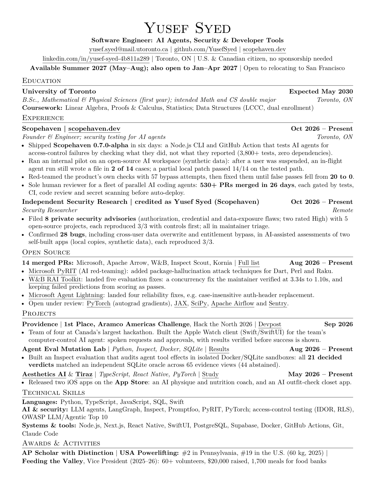
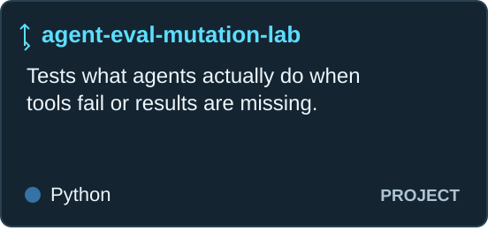
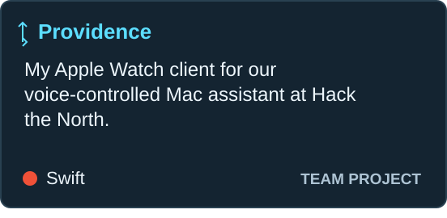
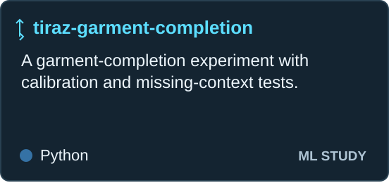
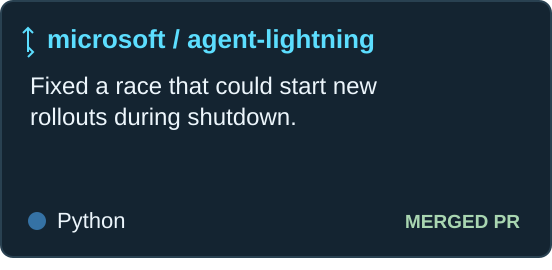
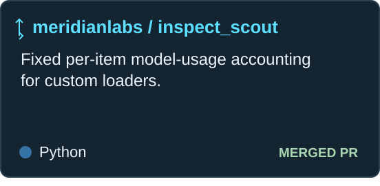
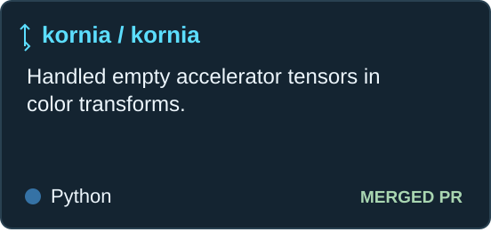
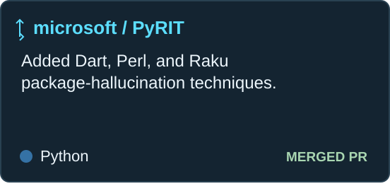
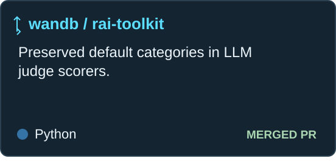
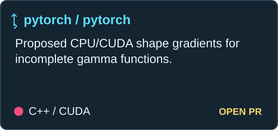

# Yusef Syed

First-year Math + CS at U of T, building [Scopehaven](https://scopehaven.dev). Looking for startup roles in SF: Summer 2027, also open to Jan–Apr 2027.

**[Resume (PDF)](resume/Yusef_Syed_Resume.pdf)** · [Email](mailto:yusef.syed@mail.utoronto.ca) · [LinkedIn](https://www.linkedin.com/in/yusef-syed-4b811a289/)

<strong>Projects</strong>

  
  
  
  

<strong>Open source</strong>

  
  
  
  
  
  

[Full list and evidence](RESEARCH_EVIDENCE.md#external-open-source)

